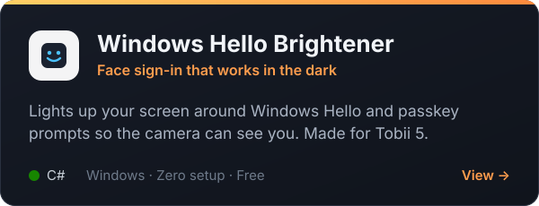
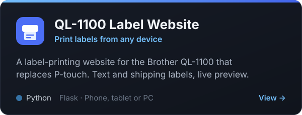

  

  
  

## ✨ Featured projects

  
  

## 🛠️ What I work with

  
  
  
  
  
  

## 💡 How I build

- **Fix real problems.** Every tool starts with something that annoyed me.
- **Zero setup.** Download, double-click, done.
- **Free, always.** No ads, no accounts, no catch.
